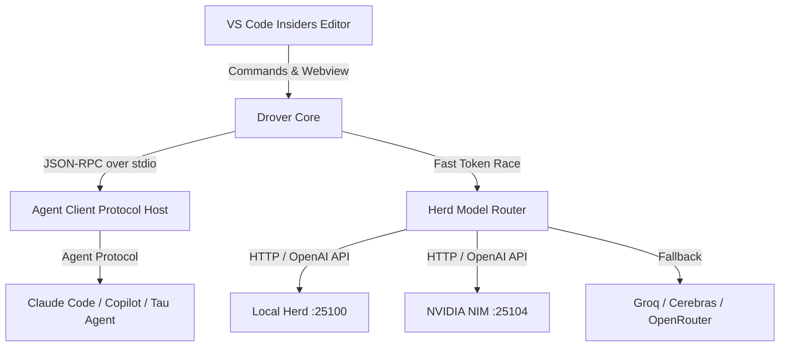

# 🤠 Drover

<div align="center">

**The Sovereign Herd Router & Autonomous Agent Client Protocol (ACP) Extension for VS Code Insiders**

[](LICENSE.txt)
[](https://code.visualstudio.com/insiders/)
[](https://agentclientprotocol.com)
[]()

*Intelligent Model Routing · Multi-Provider Herd Access · Agent Client Protocol (ACP) · Gemini EAP Retrieval*

</div>

---

## 🌟 Overview

**Drover** is the next-generation VS Code Insiders companion extension designed for local-first, low-latency, and high-performance AI-assisted engineering.

Originally branched from ModelPilot and rebuilt for the Sovereign Ranch infrastructure, Drover combines:
1. **Intelligent Model Routing & Failover**: Real-time prompt complexity scoring and routing across local llama-server herds (`127.0.0.1:25100`), NVIDIA NIM (`127.0.0.1:25104`), Groq, Cerebras, and OpenRouter with automatic zero-downtime hedging and failovers.
2. **Native Agent Client Protocol (ACP) Host**: Direct in-editor support for ACP, enabling any ACP-compatible agent (Copilot, Claude Code, Gemini CLI, Qwen Code, Codex, Tau) to communicate seamlessly via JSON-RPC.
3. **Gemini EAP & Code Retrieval**: Deep context indexing and workspace grounding that ensures your coding models receive authoritative project syntax rather than hallucinated APIs.

---

## 🚀 Key Features

### 1. Unified ACP Agent Control Surface
- **Multi-Agent Management**: Connect, steer, and manage multiple coding agents directly from the sidebar.
- **Traffic Logging & Inspection**: Real-time transparency into every JSON-RPC 2.0 exchange between the editor and the agent.
- **Permission Boundary Sandboxing**: Enforces workspace boundary protections so autonomous agents never mutate untrusted trees without explicit consent.

### 2. Autonomous Herd Routing
- **Latency-First Racing**: Race local llama-server instances and remote providers; first valid token stream wins, lagging requests are gracefully aborted.
- **Zero-Configuration Defaults**: Automatically discovers active herd endpoints on `127.0.0.1:25100` and `127.0.0.1:25104`.
- **Dynamic Context Optimization**: Automatic context-window sizing and token budgeting preventing truncation or OOMs.

### 3. Integrated Developer Workflow
- **Inline Code Editing & Diff Application**: Native tree manipulation, multi-file atomic patches, and symbol-level navigation.
- **Command Palette Integration**: Fast triggers for agent connections, turn cancellation, prompt replay, and model profile swapping.

---

## 📦 Installation & Setup

### Requirements
- **VS Code Insiders** `1.140.0+`
- **Node.js** `18+` or **Bun** `1.1+`

### Quick Install in VS Code Insiders
```bash
# Clone the repository
git clone https://github.com/toxicwind/drover.git ~/.vscode-insiders/extensions/toxic.drover-1.0.0-sovereign

# Reload VS Code Insiders
code-insiders --list-extensions | grep drover
```

---

## ⚙️ Configuration

Drover integrates cleanly into your VS Code `settings.json`:

```json
{
  "drover.approvalMode": "default",
  "drover.autoGenerateCommitMessageOnSave": true,
  "drover.streamResponses": true,
  "drover.local.baseUrl": "http://127.0.0.1:25100/v1",
  "drover.nimlocal.baseUrl": "http://127.0.0.1:25104/v1",
  "acp.autoApprovePermissions": false,
  "acp.logTraffic": true
}
```

---

## 🛠️ Architecture



---

## 📄 License

MIT License © 2026 toxicwind & Sovereign Ranch Contributors.
